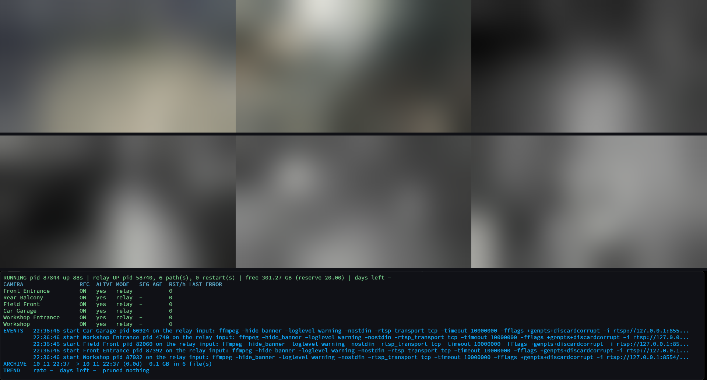

# Windows Terminal IPCCTV Dashboard

A PowerShell toolkit that turns a Windows desktop into a camera wall and a 24/7 recorder: a self-healing grid of RTSP streams tiled with Windows Terminal and `mpv`, a health strip reporting what the recorder is doing, an independent supervisor recording every camera you opt in with audio to local disk, and a browser UI that drives the lot. Nothing is recorded until you ask for it, per camera. The viewer and the recorder are separate programs that share nothing but a configuration file, so closing the dashboard does not stop recording and a recorder that is not installed does not stop you watching.



## Quick reference

- **Just the monitor** - `.\cam.ps1 -Start -Dashboard`.
- **Just the recorder** - `.\cam.ps1 -Start -Recorder`. Never `-Run` from an ordinary terminal: that console is adopted as a tab in the window you already have, and closing that window killed the supervisor four times on 2026-10-12.
- **Everything** - `.\cam.ps1 -Start`. `-Stop` and `-Status` take the same `-Recorder` / `-Dashboard` scoping, and unscoped means all of it.
- **Best way to start everything** - log on: `.\cam.ps1 -Install` puts three logon tasks in place, one each for the recorder, the dashboard and the UI - see [Install and uninstall](#install-and-uninstall). Not the UI, which cannot start itself; `cam.ps1 -Start` is the manual equivalent.
- **The UI** - two processes serving <http://127.0.0.1:8787/>, started on demand or by its logon task, and deliberately left running by `cam.ps1 -Stop` so there is always something to start things from.
- **Closing a terminal window** - each tier is a Win32 job with `KILL_ON_JOB_CLOSE` whose only handle is held by a warden outside the window, so closing the window sweeps every member and grandchild. The UI's two processes survive by design, and a hand-started `-Run` supervisor is outside all of it.

## Install and uninstall

One command installs everything that makes the system start by itself, and one removes it. First, once - the prerequisites (Windows Terminal, `mpv`, `ffmpeg`, MediaMTX) are in [docs/install.md](docs/install.md), with the execution policy and the `cameras.json` schema:

1. Run `.\mpv.cam.autolayout.autorestart.ps1`. It asks for the camera login, saves it encrypted as `camera_creds.xml`, writes a `cameras.json` template and exits. Fill in your cameras.
2. Build the UI with `ui/build.sh`, from WSL ([docs/go-toolchain.md](docs/go-toolchain.md)). Skip it and `-Install` installs everything else and reports the UI as skipped.

```powershell
.\cam.ps1 -Install -WhatIf   # the plan: every prerequisite, then each component. Changes nothing.
.\cam.ps1 -Install           # install
.\cam.ps1 -Start             # -Install starts nothing: this starts the recorder and dashboard now
.\cam.ps1 -Uninstall         # remove it again
```

**`-Install`** checks every prerequisite first and lists every problem at once with its fix; any of them stops it before it changes anything, except a missing `camui.exe`, which only skips the UI. Then, in order: the MediaMTX config generated from `cameras.json`, and the logon tasks `IPCCTV-Recorder` (the NVR window), `IPCCTV-Dashboard` (the viewer grid) and `IPCCTV-Ui`. Each reports installed, already installed, skipped or failed, one failing does not stop the rest, and it exits 0 only when all four are in place. Anything already in place is left alone, so a second run changes nothing; after updating the scripts, `-Uninstall` then `-Install` rewrites the launchers. No elevation.

**`-Uninstall`** removes the three tasks, their launchers in `%LOCALAPPDATA%\IPCCTV\` and the generated MediaMTX config. It keeps the logs, the archive, `cameras.json`, `recorder.config.json` and the credentials, and it stops nothing: `.\cam.ps1 -Stop` does that, and leaves the UI running on purpose. A second run is a clean no-op.

**Optional, elevated, once:** `.\cam.recorder.ps1 -InstallEventSource` registers the `IPCCTV` event source for [the alerts](docs/alerts.md). `-Install` does it itself when run elevated and prints this line when not; alerting works without it. `Remove-EventLog -Source IPCCTV`, elevated, removes it.

## Day to day

Everything the UI does is also a command, because the UI performs every action by calling the scripts. These three are the ones worth knowing:

```powershell
.\cam.ps1 -Status   # what is running: processes, the relay, the three logon tasks. Not disk.
.\cam.ps1 -Start    # recorder first, then the dashboard, in the order that keeps a camera slot free
.\cam.ps1 -Stop     # stops everything and verifies it, orphans included. Leaves the UI running.
```

For the disk figures - the rate footage is accruing at, free space and the days of headroom left - use `.\cam.recorder.ps1 -Status` or read the health strip. `cam.ps1 -Status` reports processes and services, not disk. Every other command is in [Reference](docs/reference.md).

**<http://127.0.0.1:8787/>** - the control UI. Open it in a browser **on Windows**. Everything starts itself at logon, so the normal state is that you touch nothing and this URL is all you need.

A `curl` to that address **from inside WSL cannot reach it** - WSL's loopback is its own, not the Windows one, so the connection is refused and a perfectly healthy UI looks down.

It has four screens:

* **Dashboard** - start and stop everything, the recorder alone or the viewers alone; a record toggle per camera with what that camera is actually doing; free space and the days of headroom left; the supervisor's recent events; and the state of each service. The actions that stop footage being written ask for confirmation first.
* **Settings** - the camera list (add, remove, rename, change the IP, the stream and the record flag) and the four recording keys it is allowed to change: segment length, reserve, hysteresis and retention days.
* **Footage** - camera, then date, then segment, with the player inline. A day's gaps are visible as gaps.
* **Live** - the cameras as a tile grid in the browser, from the live-view MediaMTX ([docs/ui.md](docs/ui.md#live-view)); off until `LiveViewEnabled` is turned on. The grid fills the window; click a tile for that camera in a large modal (main stream); sound stays muted until you unmute.

Recording is opt-in per camera: the record toggle on the Dashboard screen, or `.\cam.recorder.ps1 -Enable <name|all>` and `-Disable`. Footage lands in one folder per camera under `RootPath` (`E:\cameras` unless you change it), in 15-minute MKV segments, and the pruner deletes the oldest when free space runs low - [docs/how-it-works.md](docs/how-it-works.md#recording) has the detail.

The logs to read when something looks wrong are `_logs\recorder.log` (the supervisor) and `_logs\<Camera>.log` (each camera's `ffmpeg`) under `RootPath`, and the launcher logs `autostart.log`, `autostart-dashboard.log`, `autostart-ui.log` and `camui.log` in `%LOCALAPPDATA%\IPCCTV\`.

## When something is wrong

| Symptom | First thing to do | Detail |
| --- | --- | --- |
| **Nothing is recording and nothing is coming back.** | The NVR window was closed, and nothing restarts it: `.\cam.ps1 -Start`. | [When something stops unexpectedly](docs/troubleshooting.md#when-something-stops-unexpectedly) |
| **The strip says the supervisor is stale or missing.** | `.\cam.ps1 -Start`, then read `_logs\recorder.log` for why it stopped. | [Something is wrong](docs/troubleshooting.md#something-is-wrong) |
| **A toast or an `IPCCTV: ` event appeared.** | Look its event id up. | [The alerts](docs/alerts.md) |
| **The supervisor crashed and came back by itself.** | Nothing - not a fault. It is restarted up to five times in thirty minutes, alerting as it goes. | [When something stops unexpectedly](docs/troubleshooting.md#when-something-stops-unexpectedly) |
| **One camera has gone quiet.** | Check the camera and the network. The supervisor keeps retrying on its own. | [Something is wrong](docs/troubleshooting.md#something-is-wrong) |
| **The UI will not open.** | Open it in a browser on Windows, not from WSL. `.\cam.ps1 -Status` says what is serving the port. | [Something is wrong](docs/troubleshooting.md#something-is-wrong), [The control UI](docs/ui.md#how-it-works) |
| **`cam.ps1 -Stop` was silent.** | Nothing - an orderly stop raises no alert, on purpose. | [The alerts](docs/alerts.md) |
| **The dashboard's terminal flashes and closes immediately.** | Point `$MpvPath` at `mpv.com`, the command-line executable, not `mpv.exe`. | [Something is wrong](docs/troubleshooting.md#something-is-wrong) |
| **Streams will not connect.** | Check the IPs in `cameras.json`. | [Something is wrong](docs/troubleshooting.md#something-is-wrong) |
| **Autostart did nothing at logon.** | Read `%LOCALAPPDATA%\IPCCTV\autostart.log`. | [Autostart](docs/how-it-works.md#autostart) |
| **It behaves oddly and nothing alerted.** | Check whether it is a known limitation: they are measured, and none is hidden. | [Known limitations](docs/limitations.md) |

Every symptom with its likely cause - thirteen of them - is in [docs/troubleshooting.md](docs/troubleshooting.md).

## Documentation

Everything that is not on this page is under `docs/`, one file per subject:

* **Installing from scratch** - [docs/install.md](docs/install.md). The prerequisites, the execution policy, every step in order, the `cameras.json` schema and the credentials.
* **Troubleshooting** - [docs/troubleshooting.md](docs/troubleshooting.md). Every symptom with its likely cause and fix, and what happens when something stops unexpectedly.
* **The alerts** - [docs/alerts.md](docs/alerts.md). The three channels, every event id and how to read them back.
* **The control UI** - [docs/ui.md](docs/ui.md). Its four screens, how it runs and logs, exposing it beyond this machine, and the `camui.exe` flags.
* **How it works** - [docs/how-it-works.md](docs/how-it-works.md). Credentials, the grid, recording, retention, the relay, the health strip and autostart.
* **Command reference** - [docs/reference.md](docs/reference.md). Every command of every script, the granular install switches and the test harness.
* **Known limitations** - [docs/limitations.md](docs/limitations.md). Thirteen of them, measured rather than theoretical.
* **Configuration** - [docs/configuration.md](docs/configuration.md). Four keys are editable from the UI's Settings screen: `SegmentSeconds`, `ReserveGB`, `PruneHysteresisGB` and `MaxRetentionDays`. The rest is tuning nobody should need. Add, remove or modify cameras by editing `cameras.json`, or from the same screen.
* **The Go toolchain** for building the UI - [docs/go-toolchain.md](docs/go-toolchain.md).
* **Development notes** - [docs/development.md](docs/development.md). Harness invocation and the dashboard's diagnostic switches.
